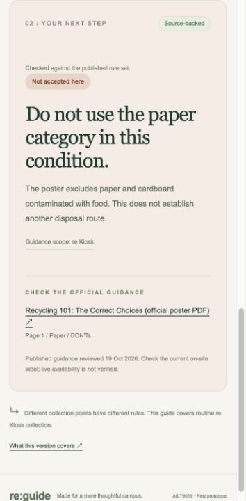
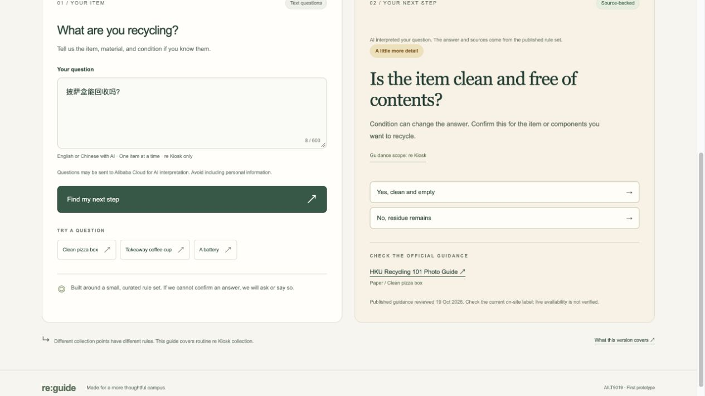
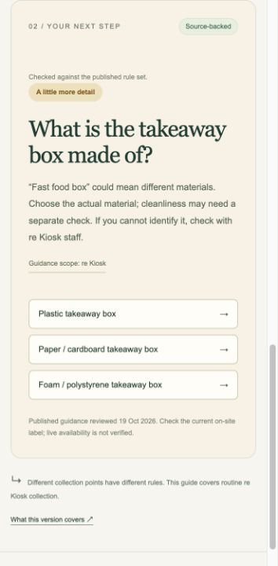

# First-prototype validation

Date: 19 October 2026 (Hong Kong).

## Automated workflow checks

Command: `node --test tests/guide.test.mjs`

**Result: 60 passed, 0 failed.** The final code was tested using the actual research JSON files.

Coverage includes accepted and excluded items, component separation, missing cleanliness, battery type and condition, unknown items, multiple-item queries, conflicting cleanliness descriptions, damaged glass, mixed materials, unsupported collection points, special-event scope, and specialist-waste referral. Citation IDs and URLs are checked against the source catalog.

The set includes 20 initial ordinary-item examples and three specialist-referral examples, followed by additional edge cases and clarification-flow tests. Expected results were written for the documented prototype workflow. These are **not** an independent recycling-policy assessment, a measured 90% accuracy result, or student usability testing.

## Browser checks

The local app was loaded in the Codex in-app browser and the following interactions were checked against the visible result:

| Check | Observed result |
|---|---|
| Clean pizza-box example | Paper category, condition, and Photo Guide citation displayed. |
| Clean takeaway coffee-cup example | Lid, sleeve, and cup-body classifications displayed separately. |
| Generic battery example | Asked for type, then condition; confirming an intact portable household rechargeable battery produced the documented category. |
| Manually typed `pizza box` | Asked about cleanliness. |
| Selecting `No, residue remains` | Excluded the item from the paper category in that condition. |
| Laboratory chemical waste in a plastic bottle | Referred to the HKU Safety Office instead of recommending plastic recycling. |
| Our sources | All nine source records and the local poster link were present. |
| About | Deterministic lookup, no connected AI model, and scope limitations were visible. |

Desktop layout was reviewed at a 1280 x 900 viewport and mobile layout at 390 x 844. No horizontal document overflow was reported by the browser at either size. Full-page screenshots were visually reviewed. No error-level browser console entries were reported during the checks.

- [Desktop preview](preview-desktop.jpg)
- [Mobile preview](preview-mobile.jpg)

## Limits of this verification

This record verifies the local prototype's implementation and selected interactions. It does not establish live bin availability, current on-site labels, unrestricted natural-language understanding, external-source uptime, or successful operation on every device. No student usability sessions have been carried out as part of this implementation.

## HTTP checks

All seven required page, JavaScript, CSS, JSON, and PDF routes returned HTTP 200. JavaScript MIME types, JSON parsing, and the PDF header were checked. Three non-public or traversal routes returned HTTP 404.

## Vercel deployment preparation - 20 October 2026

The dependency-free Node build completed successfully. All seven required output assets were present. Both JSON files parsed correctly and matched the research originals; the hosted PDF matched the original bytes. The updated browser module passed Node's syntax check. The rule engine was unchanged.

This verifies static deployment readiness only. Vercel account authorization and a successful production deployment still need to be confirmed.

## Vercel missing-data repair - 20 October 2026

The production browser reported HTTP 404 for `/data/knowledge_base.json`, preventing the interface from enabling queries. The old error text also incorrectly instructed online visitors to start Python.

The build now refreshes tracked `public/data/` and `public/sources/` compatibility assets as well as `dist/`. Both supported static hosting layouts include the browser-requested resources. Online loading failures now offer a refresh and official guidance instead of local-server instructions.

Validation: **64 tests passed, 0 failed**, comprising the existing 60 workflow checks and four new static-resource packaging checks. The packaging checks extract local URLs from the browser source and verify that they are bundled; JSON and PDF copies are compared with the maintained research files. This does not establish independent recycling accuracy. Production verification must be recorded separately after deployment.

## Bailian backend integration — 25 October 2026

Command: `npm test` using Node.js 26.8.1. **100 tests passed, 0 failed.** The static build ran as part of the suite. JavaScript syntax checks and `git diff --check` also passed.

New checks cover the school's Token Plan endpoint and default `qwen3.8-flash` request, non-thinking JSON extraction, strict fact validation, Chinese input with mocked model output, preserved missing conditions, supported-item consistency, existing English exclusions and referrals, source-catalog citations, clarification follow-ups, malformed and oversized requests, cross-origin rejection, method/content-type checks, redacted provider errors, timeout handling, per-process concurrency and minute limits, browser fallback and static-build secret isolation. Local route tests verify required assets and deny project, `.env`, backend-source and traversal paths.

All provider responses in automated tests are mocked. No real school key was supplied, no live AI request was made, and no group credits were consumed by this verification. This does not establish live model accuracy, real-account permissions, group-wide rate limits, or deployment success.

The actual Node server was started at `http://127.0.0.1:8000`. An HTTP POST without a configured key returned `503 {"error":"ai_not_configured"}` with `Cache-Control: no-store`. Browser checks confirmed that the page loads, the clean-pizza-box example visibly labels the English-rule fallback, a bare `pizza box` asks about cleanliness, and choosing “No, residue remains” calls the backend and displays the paper exclusion with the official poster citation. Inputs and submit controls were usable again after each result. The server was stopped after verification; restart it with `npm start` after filling the local `.env` key.

## Live Bailian connection check — 25 October 2026

After the user filled the ignored local `.env`, `npm start` loaded the credentials and two low-volume real AI requests were verified using the school's configured endpoint. No key value was printed or committed.

- HTTP POST `这个披萨盒上还有油，能回收吗？` returned **200**, `mode: "ai"`, `status: "not_accepted"`, and the existing **R04 / S03** paper-contamination citation.
- In the browser, `披萨盒能回收吗？` displayed “AI interpreted your question” and asked whether the item was clean and empty, preserving the missing condition rather than assuming it.
- Selecting “Yes, clean and empty” completed the backend clarification flow and displayed the paper category and **R15** citation. This follow-up uses the deterministic rules and does not make another model call.

The local server remains running at `http://127.0.0.1:8000`. `.env` was confirmed ignored by Git. These checks verify the live connection and these two interpretations only; they do not establish general model accuracy, remaining credit balance, or a production deployment.

## Fast-food box clarification and local-launch repair — 25 October 2026

The user's `Where can i throw Fast food box` query was observed in the browser on the old interface, which lacked the AI disclosure and mode notice. Port inspection confirmed that a Python process from `/Users/tonyzhang/Documents/-AILT9019-Project--main` was serving port 8000. That old launcher still ran `python3 server.py`.

The English lookup now recognises generic fast-food/takeaway box descriptions and asks for material before using any item rule. Plastic takeaway boxes retain R07 and require cleanliness clarification; generic paper/cardboard and foam takeaway boxes remain explicitly unconfirmed because no verified item rule covers them. AI fact extraction supports the same generic food-box distinctions. Dirty or negated conditions are preserved when selecting a material; existing hazardous-waste and collection-point scope checks still take precedence.

`npm test`: **114 passed, 0 failed**. Tests cover the exact reported wording, alternate packaging descriptions, both clarification steps, dirty and negated conditions, paper/foam coverage limits, fallback without AI, and mocked Chinese fact extraction. Static packaging and secret-isolation checks passed. `git diff --check` passed.

With filesystem approval, the Documents `Start.command` was changed into a local shortcut to the maintained project's launcher, preserving the original as `Start.command.before-bailian-fix`. The confirmed old Python process was stopped, and the maintained Node backend was started on port 8000 with the local environment configuration.

Actual browser verification: after refresh, the user's exact phrase displayed “What is the takeaway box made of?” with plastic, paper/cardboard and foam choices. Selecting plastic completed a real Bailian call, displayed the AI mode notice, asked whether the item was clean and empty, and cited R07 / S03. The page was then returned to the original query's material choices. This does not extend the verified recycling rules or establish unrestricted model accuracy.

## Repeated launcher invocation — 25 October 2026

The port-conflict report came from a second launch while the maintained Node service was already listening. The local server now exposes a minimal, uncached `/api/health` identity response containing only a fixed service identifier. On `EADDRINUSE`, the launcher checks that identity with a 1.5-second timeout. A matching backend prints `Already running: http://127.0.0.1:8000` and exits with status 0, leaving the existing server intact. Another application or an unreachable/nonmatching endpoint still produces an actionable port-conflict error; arbitrary listeners are not silently reused.

`npm test`: **118 passed, 0 failed**. Added checks cover the identity response, repeated launch success, foreign listeners, timeouts, and other startup errors. The build and `git diff --check` also passed.

Actual process verification: started the updated server, then ran `npm start` again while it was listening. The second command printed the existing URL and returned **exit code 0**. No external AI call was needed. The test server was then stopped so the user's next launch from the existing Documents shortcut can own the running service in their own terminal.
